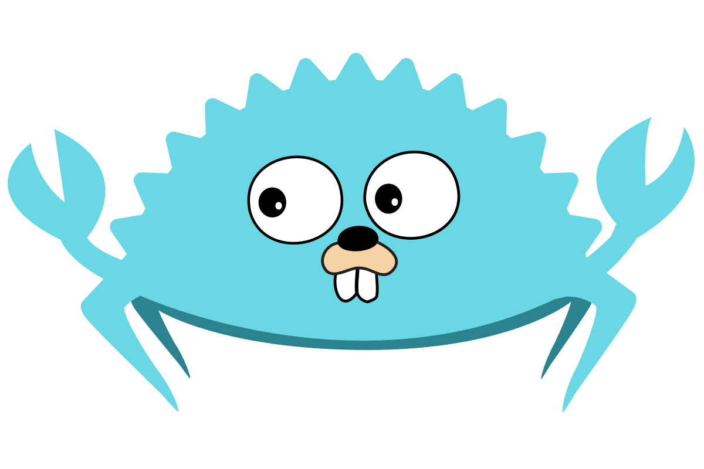

# misbrands
The world's most hated IT stickers

(there's more!)

Inspired by Sam Beckham's legendary [JavaScript sticker]( https://samdbeckham.gitlab.io/javascript_sticker/)

## Preview:

| | |
|---|---|
|  |  |
|  |  |
|  |  |
|  |  |
|  |  |
|  |  |
|  | |

## FAQ: 

### Can I print these?
Of course, that's why those are here.

### Can I buy these?
Yes, you can! Not from me, but from any custom sticker vendor of your choice.

### Will there be more?
Unlikely but still possible.
